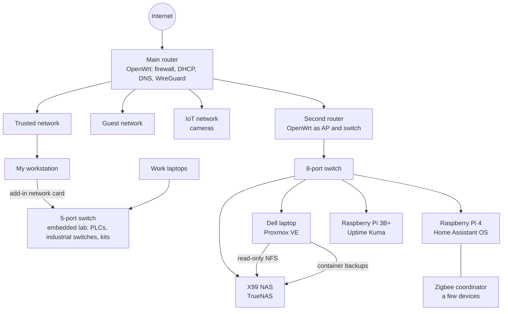

My homelab today has two routers running OpenWrt, two Raspberry Pis, a Dell laptop running Proxmox and a NAS built on an X99 board with a Xeon, inside a used case I bought for R$ 100. Most of the hardware is reused or cheap. The most expensive piece is my workstation, which I built myself 4 or 5 years ago, and no always-on service depends on it.

The idea is this: you can build something solid with little money. What makes a homelab reliable is planning and documentation, and that costs time (and tokens).

Below are the architecture, what runs on each machine, what I paid, what is missing and what comes next. IP addresses and machine names are left out.

![[20261119_152353.jpg]]

>[!faq] About the desk
>My desk is L-shaped, and I built it myself with my father's help. The right side holds all the equipment for my embedded systems work, which is outside the scope of my homelab.

## The architecture

Each machine has one main role. Home Assistant is designed not to depend on Proxmox or the NAS. Jellyfin, on the Dell, depends on the NAS to read the courses. I manage everything from my workstation or my phone.

>[!note] About my workstation
>On the workstation I use [Omarchy](https://omarchy.org/), a distribution based on Arch Linux with Hyprland. I wrote about how I got there in [[2026-11-linux-desktop-journey.en|From Windows to Omarchy: my history with Linux on the desktop]].

## What runs on each machine

### Network

Both routers are Xiaomi AX3000T running [OpenWrt](https://openwrt.org/) 25.12. The main one does PPPoE, NAT, firewall, DHCP, DNS and WireGuard, and splits the house into four networks: trusted, guest, services and IoT. The second one works only as an access point and switch for the services network, with no routing.

>[!note] Worth noting...
>The Xiaomi AX3000T does not ship with OpenWrt. The stock firmware is proprietary and, depending on the version you buy, may be in Mandarin. Everything I did to replace the firmware is described in detail in the [official OpenWrt documentation](https://openwrt.org/toh/xiaomi/ax3000t), plus a few searches in the [forum](https://forum.openwrt.org/t/openwrt-support-for-xiaomi-ax3000t/180490/3766).

With WireGuard I reach the homelab from outside without exposing any admin panel to the internet.

### Embedded lab

The workstation has an add-in network card connected to a 5-port switch, on a separate network I use as an embedded lab. PLCs, industrial switches, development boards and kits go there, whatever I am working on at the moment. I reach this lab from my workstation and from the laptops of the companies I work for.

### Home automation

A Raspberry Pi 4 with 8 GB of RAM runs Home Assistant OS on bare metal. It uses a 256 GB USB SSD instead of an SD card. It has a Zigbee coordinator (SONOFF Dongle Max, model Dongle-M) with Zigbee2MQTT and a few paired devices, such as a smart plug and temperature and humidity sensors.

I kept Home Assistant off Proxmox on purpose. If the laptop goes down, the house keeps working.

### Applications

The laptop is a Dell Inspiron 3583 with an i7-8565U, 16 GB of RAM and a 512 GB NVMe, running Proxmox VE. Today it hosts a few LXC containers and VMs, such as:

- [Plausible](https://plausible.io/), the analytics for my site, cookieless and hosted at home;
- [ai-memory](https://github.com/akitaonrails/ai-memory), the long-term memory I use with AI agents (built by Fabio Akita);
- [Jellyfin](https://jellyfin.org/), which plays my course library straight from the NAS;
- [Syncthing](https://syncthing.net/), which syncs my Obsidian vault between computer and phone and makes a daily *checkpoint* to GitHub;
- [Caddy](https://caddyserver.com/), a reverse *proxy* that gives HTTPS to the main admin panels with my own CA (certificate authority);
- [AdGuard Home](https://github.com/AdguardTeam/Adguardhome), a second filtering DNS, a replica of the one on the Pi;
- a container for my own web apps.

Early this month, with five of these containers running, the memory limits added up to 6 GB of the 16 GB, and the host used about 3.7 GB. There is still plenty of room.

The laptop's network port is 100 Mb/s, which limited copies to the NAS. A USB 3.0 Gigabit adapter (TP-Link UE300) fixed it. The original port stayed as an emergency path.

### Storage

The NAS runs TrueNAS Community Edition 25.10.7 on an X99 board with a Xeon sold as an E5-2682 v4 (16 cores and 32 *threads*), 16 GB of RAM, a 256 GB NVMe for the system and a 750 W Cooler Master power supply. The data disks are the ones I already had: two 500 GB and one 4 TB.

It serves the course library to Jellyfin over read-only NFS and stores the Proxmox container backups. I have test-restored four of those backups into an isolated container.

### Monitoring

A Raspberry Pi 3B+ runs Uptime Kuma, which watches the machines and sends alerts on Telegram. It has been down since November 6, when its SD card failed.

The Pi itself sends a *heartbeat* to [healthchecks.io](https://healthchecks.io/), which warns me if the whole house drops off the internet. With the Pi down, that alarm is off too.

The Pi used 470 MB of its 905 MB of usable memory, which is already the whole planned budget. That is why it only runs Kuma and DNS.

> Splitting the roles keeps failures small.

## Where I saved

The savings came from reusing, buying used or on sale, and buying only when a measurement shows the need. What I paid for each piece:

| Item | Where | Price |
|---|---|---|
| 2 [Xiaomi AX3000T](https://s.click.aliexpress.com/e/_c33dJh7b) routers | AliExpress | R$ 250 each |
| Raspberry Pi 3B+ | OLX, 2 years ago | R$ 200 |
| Raspberry Pi 4B | OLX | R$ 500 |
| [X99 kit (board, Xeon and memory)](https://s.click.aliexpress.com/e/_c3uV8m4Z) | AliExpress sale | R$ 800 |
| Cooler Master 750 W Gold power supply | Kabum | R$ 450 |
| 240 mm *water cooler* | Shopee | up to R$ 200 |
| SONOFF Dongle Max Zigbee coordinator | AliExpress | R$ 200 |
| NAS case | OLX | R$ 100 |
| Dell laptop | reused | already mine |
| NAS disks | reused | already mine |

In total that is about R$ 2,950, not counting the NAS NVMe, the network adapter and the cables. The prices are what I paid. The only two links in the table are affiliate links: if you buy through them, I get a commission.

The laptop is the one I used before the workstation. The old disks were tested one by one before going into use, and three others I used before were discarded after long S.M.A.R.T. tests. And the consumer routers with OpenWrt do here what I would otherwise need much more expensive network gear for.

There are things I chose not to buy. A 2.5 GbE switch, more memory for the NAS and a second application server are in the plan, but each one has a condition first: measuring that the current hardware can't cope or, for the memory, confirming that ECC works and is reported.

## Organization is the part that takes work

The whole homelab is documented in my Obsidian vault:

- the hardware inventory;
- the network and storage architecture;
- a log of changes, with the rollback plan;
- recovery guides for the main machines;
- a phased roadmap, with acceptance criteria for each phase.

The scripts live in a private Git repository, separate from the notes. SSH access uses a single config with pinned host keys, which any of my devices can install.

When the monitoring Pi's SD card died, the procedure to rebuild it from the NAS backup was already written.

> A backup that was never restored doesn't count as a backup.

## What is still missing

The setup still has gaps:

- I have no UPS. A power cut takes everything down without a clean shutdown. It is the first purchase on the list.
- Monitoring has been down since the Pi 3B+'s SD card failed on November 6, 2026. It comes back when I buy a *high-endurance* card.
- The containers have backups on the NAS (four of them have been test-restored), but those backups have no off-site copy yet, as the 3-2-1 rule asks (three copies, two different media, one off-site). Only the critical configs already go encrypted to the cloud every day.
- The two 500 GB disks form a mirror for the backups, but the 4 TB one, with the courses, has no redundancy. A 1 TB disk doesn't even show up in the system.
- The IoT network no longer reaches the internet, with one narrow exception: the cameras can only open HTTPS to Google, for their connectivity check. I explain this exception in [[2026-11-chinese-cameras-internet.en|What Chinese cameras do on the internet]].

## What comes next

The roadmap follows a dependency order, and each step has a criterion to go on or stop:

1. Buy a 1,000 to 1,500 VA UPS with USB, to shut the NAS down cleanly.
2. Buy four new 4 TB (or larger) NAS disks and build a *pool* with redundancy.
3. Move the link between the two routers to a *trunk* with VLANs.
4. Start using both filtering DNS servers (AdGuard Home), so one can fail without taking the network down. The Proxmox one is already installed, and the Pi one comes back when I rebuild the Pi.
5. Record motion clips to the cameras' SD cards. The cameras are already off the vendor cloud and show up in Home Assistant.
6. When the Dell can't cope anymore, buy a low-power Intel computer with 32 GB of RAM and an iGPU with AV1 decoding, for Jellyfin, Immich and Frigate.

## Conclusion

With consumer routers, two Raspberry Pis, a laptop and a NAS built from cheap parts and old disks, you can have a segmented network, VPN, internal HTTPS, home automation, media, monitoring and tested backups.

What makes it work is organization: separate roles, documented changes and purchases made after measuring.
