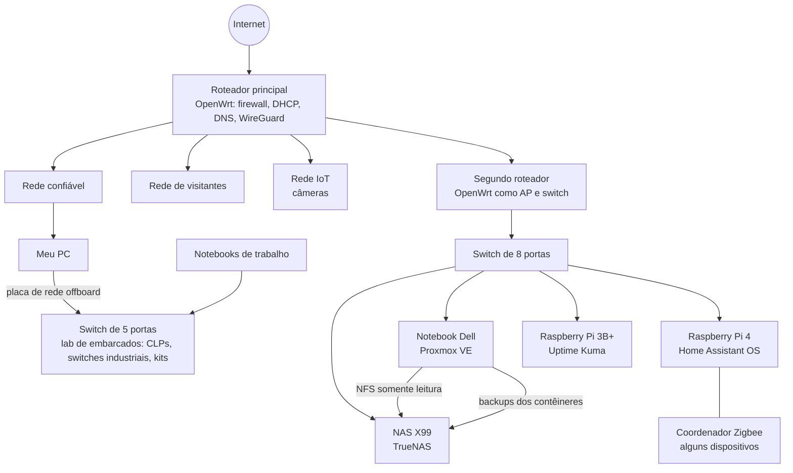

Meu homelab hoje tem dois roteadores com OpenWrt, dois Raspberry Pi, um notebook Dell rodando Proxmox e um NAS montado numa placa X99 com Xeon, dentro de um gabinete usado que comprei por R$ 100. A maior parte do hardware é reaproveitada ou barata. A peça mais cara é o meu PC, montado por mim há 4 ou 5 anos, e nenhum serviço que fica sempre ligado depende dele.

A ideia aqui é a seguinte: dá pra construir algo robusto com pouco dinheiro. O que faz um homelab ser confiável é planejamento e documentação, e isso custa tempo (e tokens).

Abaixo estão a arquitetura, o que roda em cada máquina, quanto eu paguei, o que falta e o que vem depois. Endereços IP e nomes de máquina ficam de fora.

![[20261119_152353.jpg]]

>[!faq] Sobre a mesa
>Minha mesa é em L e eu mesmo fiz com a ajuda do meu pai. Na parte da direita, ficam todos os equipamentos do meu trabalho com embarcados e que não fazem parte do escopo do meu homelab.

## A arquitetura

Cada máquina tem uma função principal. O Home Assistant foi pensado pra não depender do Proxmox nem do NAS. O Jellyfin, no Dell, depende do NAS pra ler os cursos. Eu administro tudo do meu PC/smartphone.

>[!note] Sobre o meu PC
>No PC eu uso o [Omarchy](https://omarchy.org/), uma distribuição baseada no Arch Linux com Hyprland. Contei como cheguei nele em [[2026-11-linux-desktop-journey.pt-br|Do Windows ao Omarchy: minha relação com o Linux no desktop]].

## O que roda em cada máquina

### Rede

Os dois roteadores são Xiaomi AX3000T com [OpenWrt](https://openwrt.org/) 25.12. O principal faz PPPoE, NAT, firewall, DHCP, DNS e WireGuard, e separa a casa em quatro redes: confiável, visitantes, serviços e IoT. O segundo trabalha só como access point e switch da rede de serviços, sem roteamento.

>[!note] Vale ressaltar...
>Xiaomi AX3000T não vem com o OpenWrt de fábrica. Tudo proprietário, e dependendo da versão que comprar, pode ser em mandarim. Tudo o que fiz para trocar o firmware está descrito em detalhes na [documentação oficial do OpenWrt](https://openwrt.org/toh/xiaomi/ax3000t) e mais algumas consultas no [fórum](https://forum.openwrt.org/t/openwrt-support-for-xiaomi-ax3000t/180490/3766).

Com o WireGuard eu acesso o homelab de fora sem expor nenhum painel de administração na internet.

### Lab de embarcados

O PC tem uma placa de rede *offboard* ligada a um switch de 5 portas, numa rede separada que uso como lab de embarcados. Ali entram CLPs, switches industriais, placas de desenvolvimento e kits, o que eu estiver trabalhando no momento. Acesso esse lab tanto pelo meu PC quanto pelos notebooks das empresas em que trabalho.

### Automação da casa

Um Raspberry Pi 4 com 8 GB de RAM roda o Home Assistant OS direto no hardware. Ele usa um SSD USB de 256 GB em vez de cartão SD. Ele tem um coordenador Zigbee (SONOFF Dongle Max, modelo Dongle-M) com Zigbee2MQTT e alguns dispositivos pareados, como tomada inteligente e sensores de temperatura e umidade.

Deixei o Home Assistant fora do Proxmox de propósito. Se o notebook cair, a casa continua funcionando.

### Aplicações

O notebook é um Dell Inspiron 3583 com i7-8565U, 16 GB de RAM e NVMe de 512 GB, rodando Proxmox VE. Hoje ele hospeda alguns contêineres LXC e VMs, como:

- [Plausible](https://plausible.io/), a análise de acessos do meu site, sem cookies e hospedada em casa;
- [ai-memory](https://github.com/akitaonrails/ai-memory), a memória de longo prazo que uso com agentes de IA (desenvolvido pelo Fabio Akita);
- [Jellyfin](https://jellyfin.org/), que toca minha biblioteca de cursos direto do NAS;
- [Syncthing](https://syncthing.net/), que sincroniza meu vault do Obsidian entre computador e celular e faz um *checkpoint* diário no GitHub;
- [Caddy](https://caddyserver.com/), um *proxy* reverso que dá HTTPS aos principais painéis de administração com uma CA (autoridade certificadora) própria;
- [AdGuard Home](https://github.com/AdguardTeam/Adguardhome), um segundo DNS com filtro, réplica do que roda no Pi;
- um contêiner pros meus próprios apps web.

No começo desse mês, com cinco desses contêineres rodando, os limites de memória somados davam 6 GB dos 16 GB, e o host usava cerca de 3,7 GB. Ainda cabe bastante coisa.

A porta de rede do notebook é de 100 Mb/s, o que limitava as cópias pro NAS. Um adaptador USB 3.0 Gigabit (TP-Link UE300) resolveu. A porta original ficou como caminho de emergência.

### Armazenamento

O NAS roda TrueNAS Community Edition 25.10.7 numa placa X99 com um Xeon vendido como E5-2682 v4 (16 núcleos e 32 *threads*), 16 GB de RAM, NVMe de 256 GB pro sistema e fonte Cooler Master de 750 W. Os discos de dados são os que eu já tinha: dois de 500 GB e um de 4 TB.

Ele serve a biblioteca de cursos pro Jellyfin por NFS somente leitura e guarda os backups dos contêineres do Proxmox. Já testei a restauração de quatro desses backups num contêiner isolado.

### Monitoramento

Um Raspberry Pi 3B+ roda o Uptime Kuma, que vigia as máquinas e manda alerta no Telegram. Ele está parado há um mês, quando o cartão SD falhou.

O próprio Pi manda um *heartbeat* pro [healthchecks.io](https://healthchecks.io/), que avisa se a casa inteira some da internet. Com o Pi parado, esse aviso também está fora do ar.

O Pi usava 470 MB dos 905 MB utilizáveis, o que já é todo o orçamento previsto. Por isso ele fica só com o Kuma e o DNS.

> Separar as funções deixa as falhas pequenas.

## Onde economizei

A economia veio de reaproveitar, de comprar usado ou em promoção e de comprar só quando uma medição mostra a necessidade. O que eu paguei em cada peça:

| Peça                                                                          | Onde                | Quanto       |
| ----------------------------------------------------------------------------- | ------------------- | ------------ |
| 2 roteadores [Xiaomi AX3000T](https://s.click.aliexpress.com/e/_c33dJh7b)     | AliExpress          | R$ 250 cada  |
| Raspberry Pi 3B+                                                              | OLX, há 2 anos      | R$ 200       |
| Raspberry Pi 4B                                                               | OLX                 | R$ 500       |
| [Kit X99 (placa, Xeon e memória)](https://s.click.aliexpress.com/e/_c3uV8m4Z) | promoção AliExpress | R$ 800       |
| Fonte Cooler Master 750 W Gold                                                | Kabum               | R$ 450       |
| *Water cooler* de 240 mm                                                      | Shopee              | até R$ 200   |
| Coordenador Zigbee SONOFF Dongle Max                                          | AliExpress          | R$ 200       |
| Gabinete do NAS                                                               | OLX                 | R$ 100       |
| Notebook Dell                                                                 | reaproveitado       | já era meu   |
| Discos do NAS                                                                 | reaproveitados      | já eram meus |

Somando, dá cerca de R$ 2.950, sem contar o NVMe do NAS, o adaptador de rede e os cabos. Os preços são os que eu paguei. Os únicos dois links da tabela são de afiliado: se você comprar por eles, eu recebo uma comissão.

O notebook é o que eu usava antes do PC. Os discos antigos foram testados um por um antes de entrar em uso, e três outros que eu usava antes foram descartados depois de testes longos de S.M.A.R.T. E os roteadores de consumo com OpenWrt fazem aqui o que eu precisaria de um equipamento de rede bem mais caro pra fazer.

Tem coisas que eu deixei de comprar de propósito. Switch de 2,5 GbE, mais memória pro NAS e um segundo servidor de aplicações estão no plano, mas cada um tem uma condição antes: medir que o hardware atual não dá conta ou, no caso da memória, confirmar que o ECC funciona e é reportado.

## Organização é a parte que dá trabalho

Todo o homelab está documentado no meu vault do Obsidian:

- o inventário de hardware;
- a arquitetura de rede e de armazenamento;
- um registro das mudanças, com o plano de volta;
- guias de recuperação pras principais máquinas;
- um roteiro em fases, com critério de aceitação em cada uma.

Os scripts ficam num repositório Git privado, separado das notas. O acesso SSH usa uma configuração única com as chaves dos hosts fixadas, que qualquer dispositivo meu pode instalar.

Um exemplo real: quando o cartão SD do Pi de monitoramento queimou, o procedimento pra reconstruir ele a partir do backup no NAS já estava escrito.

> Backup que nunca foi restaurado não conta como backup.

## O que ainda falta

O setup ainda tem buracos:

- Não tenho nobreak. Uma queda de energia desliga tudo sem desligamento limpo. É a primeira compra da lista.
- O monitoramento está parado desde que o cartão SD do Pi 3B+ falhou. Ele volta quando eu comprar um cartão *high-endurance*.
- Os contêineres têm backup no NAS (a restauração de quatro deles já foi testada), mas esses backups ainda não têm cópia fora de casa, como pede a regra 3-2-1 (três cópias, duas mídias diferentes, uma fora de casa). Só as configurações críticas já vão criptografadas pra nuvem todo dia.
- Os dois discos de 500 GB formam um espelho pros backups, mas o de 4 TB, com os cursos, não tem redundância. Um disco de 1 TB nem aparece no sistema.
- A rede IoT não sai mais pra internet, com uma exceção estreita: as câmeras só podem abrir HTTPS pro Google, pra checagem de conexão. Expliquei essa exceção em [[2026-11-chinese-cameras-internet.pt-br|O que as câmeras chinesas fazem na internet]].

## O que vem depois

O roteiro segue uma ordem de dependência, e cada etapa tem um critério pra seguir ou parar:

1. Comprar um nobreak de 1.000 a 1.500 VA com USB, pra desligar o NAS de forma limpa.
2. Comprar quatro discos novos de 4 TB (ou mais) pra NAS e montar um *pool* com redundância.
3. Passar a ligação entre os dois roteadores pra um *trunk* com VLANs.
4. Passar a usar os dois DNS com filtro (AdGuard Home), pra que um possa cair sem derrubar a rede. O do Proxmox já está instalado, e o do Pi volta quando eu reconstruir o Pi.
5. Gravar os clipes de movimento no cartão SD das câmeras, que já saíram da nuvem do fabricante e aparecem no Home Assistant.
6. Quando o Dell não der mais conta, comprar um computador Intel de baixo consumo, com 32 GB de RAM e iGPU com decodificação AV1, pra Jellyfin, Immich e Frigate.

## Conclusão

Com roteadores de consumo, dois Raspberry Pi, um notebook e um NAS montado com peças baratas e discos antigos, dá pra ter rede segmentada, VPN, HTTPS interno, automação da casa, mídia, monitoramento e backup testado.

O que faz isso funcionar é a organização: funções separadas, mudanças documentadas e compras feitas depois de medir.
